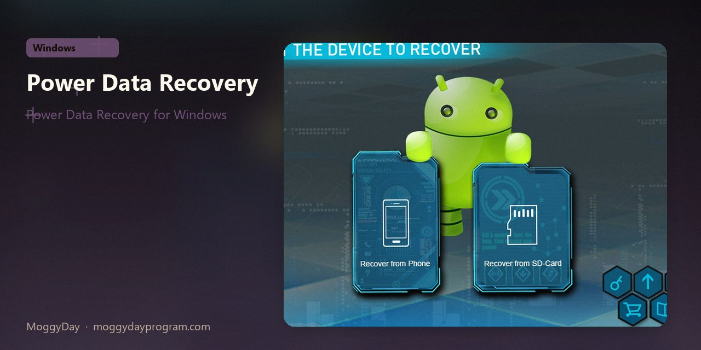
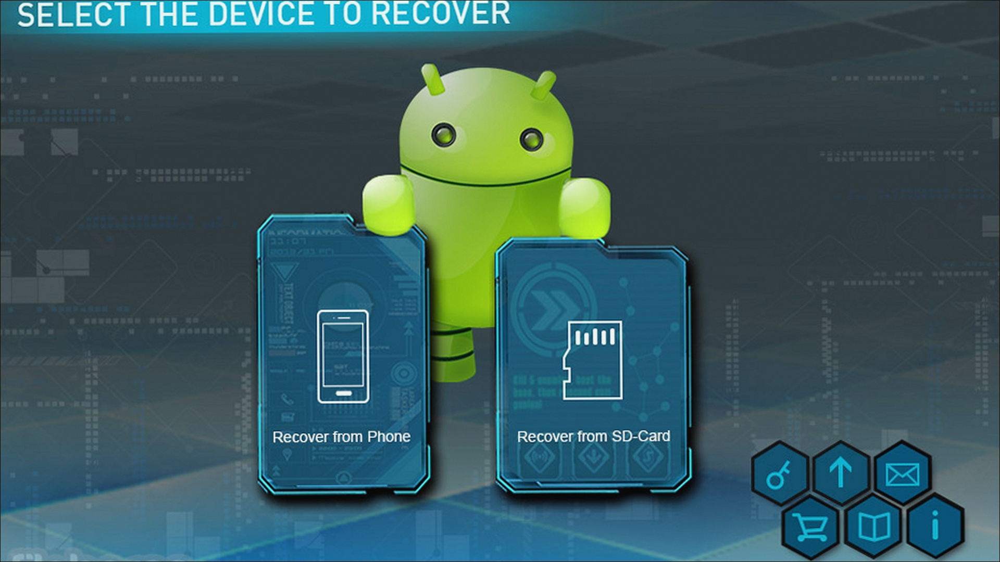
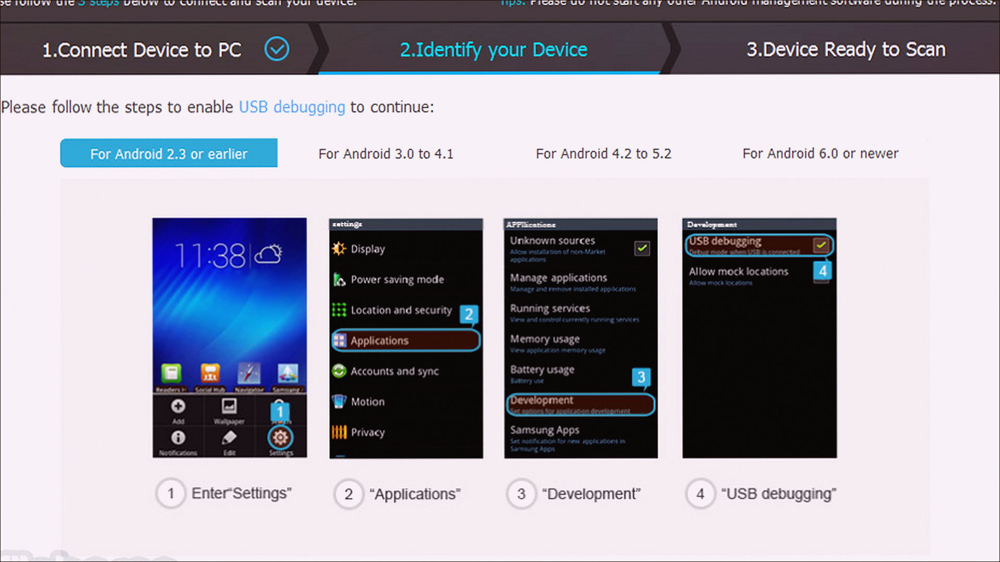
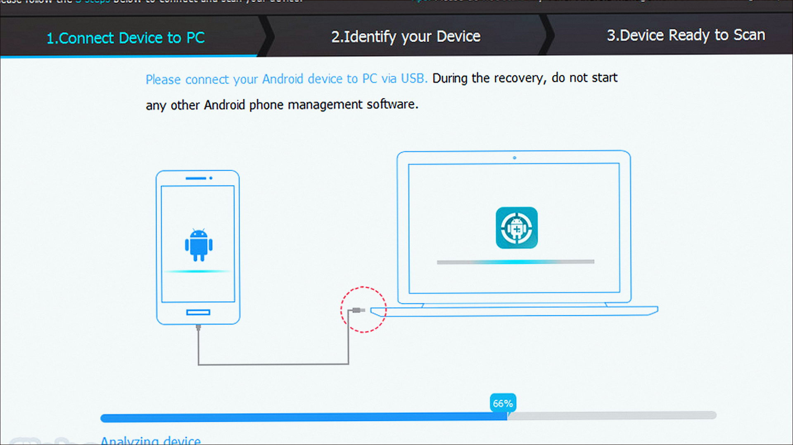

# Power Data Recovery 13.1.0

MiniTool Power Data Recovery on Windows 10/11 x64. 136 MB. Requirements, screenshots, MoggyDay Launcher.

Site: [EN](https://moggydayprogram.com/en/programs/minitool-power-data-recovery) · [RU](https://moggydayprogram.com/programs/minitool-power-data-recovery) · [Pages](https://laserbetweenmap.github.io/minitool-power-data-recovery-windows/)

  

  
  
  

## Power Data Recovery for Windows

- Size: 136 MB
- Updated: 15 Oct 2026
- Windows 10/11 x64

## Links

- https://moggydayprogram.com/en/programs/minitool-power-data-recovery
- https://moggydayprogram.com/programs/minitool-power-data-recovery
- https://moggydayprogram.com/categories/system

Also: 
- [Recuva](https://moggydayprogram.com/programs/recuva)
- [R-Studio](https://moggydayprogram.com/programs/r-studio)

Pages: https://laserbetweenmap.github.io/minitool-power-data-recovery-windows/
